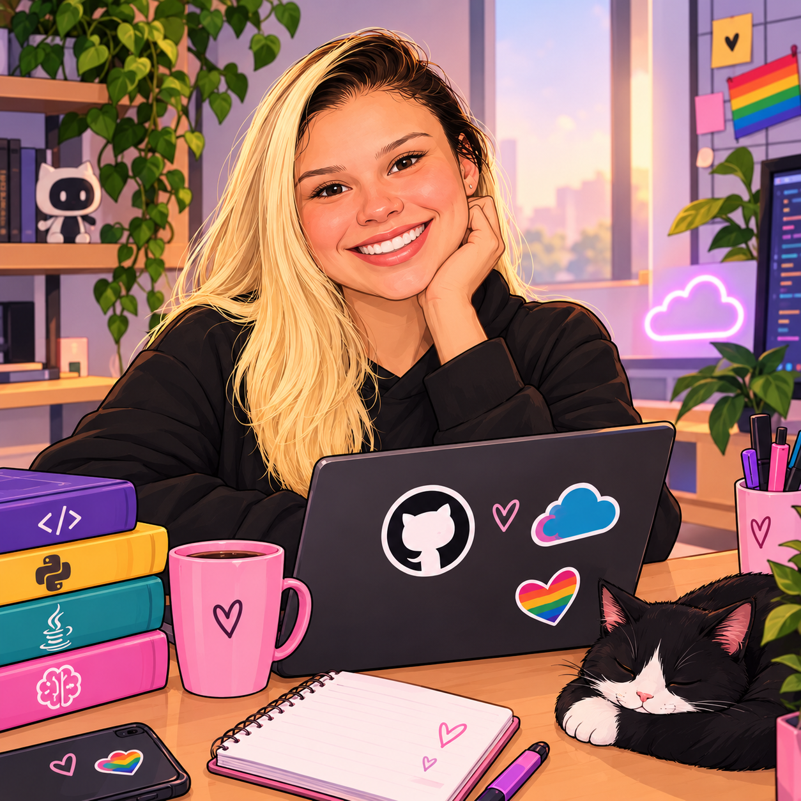

  

# 👩‍💻 Olá! Eu sou a Bruna Mendes!

Sou uma entusiasta da tecnologia, curiosa e comprometida com o aprendizado contínuo.

🎓 Atualmente, estudo Fundamentos da Tecnologia e Programação pela Escola da Nuvem, com foco em Java e Python. Também possuo formação em Inteligência Artificial pela StartSe.

🚀 **Meu objetivo:** tornar-me desenvolvedora de software e, futuramente, engenheira de software, criando soluções criativas e inovadoras.

### 💻 Habilidades e conhecimentos
- Java e Python (em aprendizado)
- Fundamentos da Tecnologia
- Inteligência Artificial
- Pacote Office
- Comunicação e treinamento
- Inglês básico, em desenvolvimento

### 🌈 Sobre mim
Sou uma mulher LGBT e neurodivergente (autista e TDAH). Acredito que a diversidade e diferentes formas de pensar contribuem para uma tecnologia mais inclusiva, acessível e inovadora.

📚 Estou sempre aprendendo, evoluindo e construindo meu caminho na tecnologia, um código de cada vez!

✨ *Grandes sonhos exigem grandes passos.* 💜
